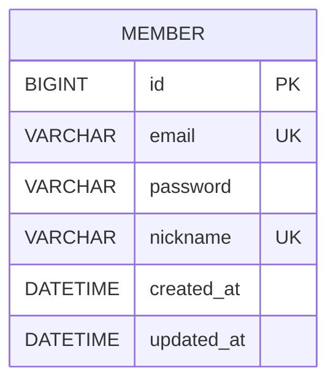
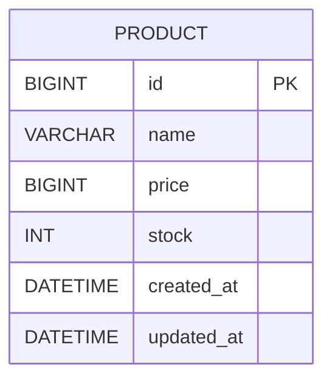

# DB 명세

## ERD

## member

| 컬럼 | 타입 | NULL | 키 | 설명 |
|---|---|---|---|---|
| id | BIGINT AUTO_INCREMENT | N | PK | 회원 식별자 |
| email | VARCHAR | N | UK | 로그인 이메일. 길이·형식 결정 필요 D1, 중복 불가 결정 필요 D2 |
| password | VARCHAR | N | | 암호화 저장 값. 저장 방식 결정 필요 D3, 검증 규칙 결정 필요 D4 |
| nickname | VARCHAR | N | UK | 회원 닉네임. 중복 불가. 길이 결정 필요 D5 |
| created_at | DATETIME | N | | 가입 일시 (BaseTimeEntity) |
| updated_at | DATETIME | N | | 수정 일시 (BaseTimeEntity) |

## ERD (product)

## product

| 컬럼 | 타입 | NULL | 키 | 설명 |
|---|---|---|---|---|
| id | BIGINT AUTO_INCREMENT | N | PK | 상품 식별자 |
| name | VARCHAR | N | | 상품명. 길이 결정 필요 D2, 중복 처리 결정 필요 D5 |
| price | BIGINT | N | | 상품 가격(원). 범위 결정 필요 D3 |
| stock | INT | N | | 재고 수량. 필드 포함 여부·범위 결정 필요 D1 |
| created_at | DATETIME | N | | 등록 일시 (BaseTimeEntity) |
| updated_at | DATETIME | N | | 수정 일시 (BaseTimeEntity) |

등록자(member_id), 카테고리, 이미지, 상품 설명은 요구사항에 없어 포함하지 않았다. 필요 여부는 결정 필요 D4, D6, D7.
